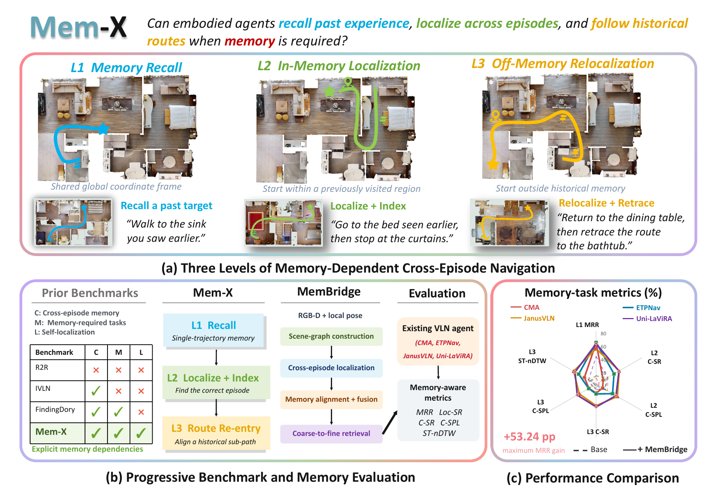

<div align="center">

# Mem-X

**A Memory-Dependent Cross-Episode Benchmark for Vision-and-Language Navigation**

<p align="center">
  <a href="https://github.com/Zhikang-Shi/Mem-X"></a>
  <a href="https://huggingface.co/datasets/KangThomas/Mem-X/tree/main"></a>
  <a href="LICENSE"></a>
</p>

<p align="center">
  <a href="https://github.com/Zhikang-Shi/Mem-X"><b>Code</b></a>
  &nbsp;·&nbsp;
  <a href="https://huggingface.co/datasets/KangThomas/Mem-X/tree/main"><b>Dataset</b></a>
  &nbsp;·&nbsp;
  <a href="assets/Mem-X_teaser.pdf"><b>Teaser</b></a>
</p>

The paper is under review. A public paper link will be added here when it is available.



</div>

Mem-X asks whether an embodied agent can recall a past target, localize against an earlier episode, and follow a historical route when the instruction depends on memory. Episodes are grouped into sessions on HM3D. Level 1 recalls an object in one shared global frame. Level 2 localizes inside a previously visited region. Level 3 starts outside that memory and then retraces a historical route.

Four policies are evaluated on the same episodes: [ETPNav](https://github.com/MarSaKi/ETPNav), [CMA](https://github.com/jacobkrantz/VLN-CE), [Uni-LaViRA](https://github.com/NJU-R-L-Group-Embodied-Lab/uni-lavira-code), and [JanusVLN](https://github.com/MIV-XJTU/JanusVLN). +MemBridge is the default. Native navigation uses the same basic tasks and does not read the scene graph, so memory-task scores stay comparable.

Paths below are relative to the repository root.

## Setup

### 1. Models

Clone the four model codebases into `baselines/models`.

```bash
git clone https://github.com/MarSaKi/ETPNav.git baselines/models/ETPNav
git clone https://github.com/jacobkrantz/VLN-CE.git baselines/models/CMA
git clone https://github.com/MIV-XJTU/JanusVLN.git baselines/models/JanusVLN
git clone https://github.com/NJU-R-L-Group-Embodied-Lab/uni-lavira-code.git baselines/models/uni-lavira-code
mv baselines/models/uni-lavira-code/sim-code/habitat baselines/models/Uni-LaViRA
```

The launchers read those four directories. Override them with `ETPNAV_ROOT`, `CMA_ROOT`, `UNI_ROOT` or `UNILAVIRA_ROOT`, and `JANUS_ROOT` only when the checkouts live somewhere else.

ETPNav and Uni-LaViRA both ship a package named `vlnce_baselines`. Import only one of them in a process.

<a id="dataset"></a>

### 2. Dataset

`datasets/` and `baselines/models/` are not part of this git repository. Download the episodes from [KangThomas/Mem-X](https://huggingface.co/datasets/KangThomas/Mem-X/tree/main) into `datasets/`.

```bash
hf download KangThomas/Mem-X --repo-type dataset --local-dir datasets
```

```text
datasets/level1/level1.json
datasets/level1/level1_gt.json
datasets/level2/level2.json
datasets/level2/level2_gt.json
datasets/level3/level3.json
datasets/level3/level3_gt.json
```

`levelN.json` holds the episodes. `levelN_gt.json` is keyed by `episode_id` and stores `locations`, `actions`, and `forward_steps`. Each level also has `datasets/levelN/protocol.json`. Habitat role splits live under `datasets/levelN/habitat/` and are rebuilt by `scripts/materialize_habitat_splits.py`. The shared field list is [`datasets/EPISODE_SCHEMA.json`](datasets/EPISODE_SCHEMA.json).

| Level | Roles | Episodes |
|---|---|---|
| 1 | ep0–ep4 | 315 / 315 / 221 / 34 / 1 |
| 2 | ep0–ep2 | 238 each |
| 3 | ep0–ep2 | 157 each |

`episode_id` is the row id, for example `level1_00800_002_ep1` or `level3_000_ep0`. `task_type` is `basic` or `memory`. Basic tasks build memory and are shared by native and +MemBridge. Success is a final Habitat geodesic of at most 3 m. STOP is not required.

HM3DSem meshes are not part of this repository. Every episode `scene_id` is relative to `SCENES_DIR` and uses the val split, for example `hm3dsem/val/00800-TEEsavR23oF/TEEsavR23oF.basis.glb`.

Download HM3D v0.2 from the official Matterport repository: [matterport/habitat-matterport-3dresearch](https://github.com/matterport/habitat-matterport-3dresearch). Use the **val** rows: the Habitat archive, the semantic annotations, and the semantic configs. Access is academic and non-commercial. Accept the terms on that page, then download the archives linked there.

Unpack them so the Habitat val tree sits under `hm3dsem/val/`. A local `scenes/` directory at the repository root is a suitable place. It is gitignored.

```text
scenes/hm3dsem/val/00800-TEEsavR23oF/TEEsavR23oF.basis.glb
```

```bash
export SCENES_DIR="$PWD/scenes"
```

### 3. Environment

Runtime packages are pinned in [`environment.yml`](environment.yml). The env name in that file is `memx`. Python is 3.8.20, PyTorch is 2.4.1+cu118, and Transformers is 4.46.3.

```bash
conda env create -f environment.yml
conda activate memx
```

That file does not install Habitat. After it finishes, install these two from source at version 0.1.7:

- habitat-lab, imported as `habitat`
- habitat-sim, imported as `habitat_sim`

Magnum is the Python binding produced by that habitat-sim build. The image records it as `magnum==0.0.0`. There is no separate Magnum package to install, and `pip install magnum` will not provide it.

The Docker image `mem-x:latest` already contains all three inside `/opt/conda/envs/lavira`. Scripts call that interpreter. Image pull and mounts are in [`ENVIRONMENT.md`](ENVIRONMENT.md).

## Running

`DRY_RUN` defaults to `0` and starts containers. `DRY_RUN=1` prints the plan.

```bash
export SCENES_DIR="$PWD/scenes"
export VLM_ENV_FILE="$PWD/vlm.env"
export MODELS_DIR=/path/to/models

PIPELINE=membridge MODEL=etpnav bash scripts/level1/level1.sh
PIPELINE=native MODEL=janus bash scripts/level2/level2.sh
bash scripts/level3/level3.sh cma
```

`PIPELINE` is `membridge` (also `+membridge` or `plus`) or `native` (also `original`). `MODEL` is `etpnav`, `cma`, `unilavira`, or `janus`. The first positional argument sets the model as well.

Janus launchers still mount a streamvln env through `JANUS_ENV`. JanusVLN_Extra weights and the ETPNav checkpoint stay outside this repository.

### API endpoint and key

The vision-language calls read the endpoint and the key from the environment. Set them yourself. This repository does not contain an API key, a base URL, or a model name.

Create a local env file and pass it as `VLM_ENV_FILE`. Do not commit that file.

```bash
# vlm.env  (local only)
VA_BASE_URL=https://your-endpoint.example/v1
VA_MODEL_NAME=your-model-name
VA_API_KEY=your-api-key
```

```bash
export VLM_ENV_FILE="$PWD/vlm.env"
```

`VA_BASE_URL` is the API site, `VA_MODEL_NAME` is the model id, and `VA_API_KEY` is the secret. Language-action calls, when used, take `LA_BASE_URL`, `LA_MODEL_NAME`, and `LA_API_KEY` the same way.

## Layout

```text
baselines/run.py        shared entry
baselines/adapt/        policy adapters
baselines/runners/      level runners and stage.py
baselines/models/       ETPNav, CMA, Uni-LaViRA, JanusVLN
membridge/              scene graph, navigation, maps, retrieval, VLM, exploration, localization
scripts/levelN/         levelN.sh, levelN_membridge.sh, levelN_native.sh
datasets/levelN/        episodes, ground truth, protocol
environment.yml         conda env memx
```

## Contributing

See [CONTRIBUTING.md](CONTRIBUTING.md). Report security issues through [SECURITY.md](SECURITY.md).

```bash
python -m unittest discover -s tests -v
```

## License

Mem-X is released under the [Apache License 2.0](LICENSE).

`baselines/models/` contains upstream checkouts. ETPNav, CMA, Uni-LaViRA, JanusVLN, and CLIP keep the licenses in their own directories. Those terms apply to that code.

